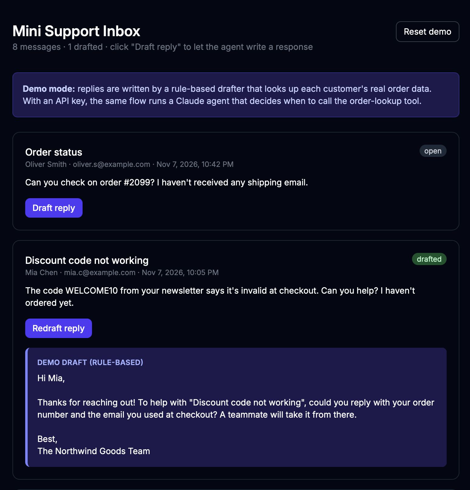

# Mini Support Inbox

A tiny AI-assisted customer-support inbox for a fictional Shopify store. It lists customer messages, and when you click **Draft reply**, an agent writes a reply. The agent can look up the customer's real order in MongoDB before it answers. The draft is saved to the database and shown under the message.

The app has two drafting modes, chosen automatically:
- **Claude mode** (`ANTHROPIC_API_KEY` set) uses a tool-using agent on the Claude API.
- **Demo mode** (no key, free) uses a rule-based drafter that calls the same `lookupOrder` tool. It lets the whole app run without paying for an API key.


<!-- TODO: add a screenshot at docs/screenshot.png -->

## Stack

| Layer | Tech |
| --- | --- |
| UI + server routes | **React Router v8 (framework mode)**, React 19, TypeScript, Tailwind |
| Agent | **Claude API** (`@anthropic-ai/sdk`), a hand-written tool-use loop with one tool |
| Database | **MongoDB** (official `mongodb` driver, Atlas free tier) |
| Runtime | Node.js 22+ |

> **Why not Remix?** Remix v2 was merged into React Router v7, so "Remix" apps are now built with React Router's *framework mode*. The concepts are the same: route modules with a server `loader` and `action`, forms that post to actions, and automatic revalidation. This project uses the current release, v8.

## Setup

1. **Install dependencies**
   ```bash
   npm install
   ```
2. **Create a free MongoDB Atlas cluster** (M0)
   - Create a cluster, then a database user.
   - Under *Network Access*, allow your IP.
   - Under *Connect → Drivers*, copy the connection string.
3. **Configure environment**
   ```bash
   cp .env.example .env
   ```
   Fill in `MONGODB_URI`. `ANTHROPIC_API_KEY` is optional; without it the app runs in demo mode. `.env` is git-ignored, so never commit real keys.
4. **Seed fake orders and messages**
   ```bash
   npm run seed
   ```
5. **Run it**
   ```bash
   npm run dev
   ```
   Open http://localhost:5173.

## How it works

```
[Draft reply button]
   │  fetcher.Form POST (messageId)
   ▼
action()  app/routes/home.tsx              ← server only
   │  validate id, load message from MongoDB
   ▼
draftReply()  app/lib/agent.server.ts
   │  Claude mode: loop ─► Claude asks for lookupOrder("#1004")
   │                       ─► we run it (MongoDB) ─► send result back
   │                       ─► Claude writes the final reply
   │  Demo mode:  regex finds "#1004" ─► lookupOrder ─► template by order status
   ▼
action() saves { draft, draftSource, status: "drafted" }  (or { status: "error", error })
   ▼
React Router re-runs loader() → card re-renders with the draft
```

- **`app/routes/home.tsx`** holds the whole page. `loader` reads messages, `action` drafts one reply, and the components render the UI. Each card has its own `useFetcher`, so it shows its own "Drafting…" state, and several drafts can run at the same time.
- **`app/lib/agent.server.ts`** contains the `lookupOrder` tool and both drafters. In Claude mode, the system prompt holds the store policies and the tool is described with a strict JSON schema. A plain `for` loop calls `messages.create`, and whenever `stop_reason` is `tool_use` it runs the tool and sends back a `tool_result`. The loop ends when Claude replies with text, capped at 5 turns.
- **`app/lib/db.server.ts`** keeps one cached `MongoClient` and exposes typed `messages` and `orders` collections. The `.server.ts` suffix guarantees this code never ships to the browser.
- **`scripts/seed.ts`** resets both collections with 6 orders and 8 messages. The messages cover order status, a refund, a wrong item, a shipping delay, an address change, a missing refund, a discount code, and an unknown order. It runs directly on Node with built-in TypeScript type stripping.

### Environment variables

| Name | Required | Purpose |
| --- | --- | --- |
| `MONGODB_URI` | yes | MongoDB / Atlas connection string |
| `ANTHROPIC_API_KEY` | no | Turns on Claude mode; without it, demo mode |
| `ANTHROPIC_MODEL` | no | Claude model (default `claude-opus-5-5`) |
| `MONGODB_DB` | no | Database name (default `mini_support_inbox`) |

## Possible next steps

- **Auth.** Add agent logins and per-store data isolation.
- **Human-in-the-loop.** Let support staff edit, approve, and send drafts, and track which ones they edited.
- **Multi-agent handoffs.** A triage agent could route to refund, shipping, or product specialists.
- **Trace viewer.** Show which tools the agent called and why, using the SDK's tracing.
- **Real Shopify integration.** Replace the fake `orders` collection with the Shopify Admin API, and verify the customer's email matches the order.
- **Campaigns and proactive messages.**
- **Ops.** Add Redis caching for order lookups, plus Docker and Cloud Run deploy. The `Dockerfile` comes from the React Router template and hasn't been tested yet.
